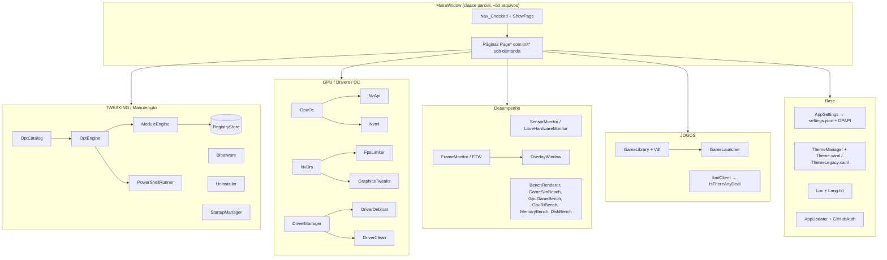
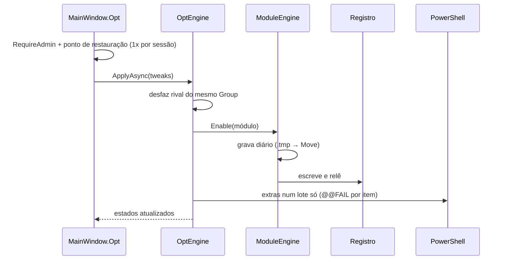

# Mapa do código — PcismoMaster

> Gerado pelo Cartographer. Último mapeamento: 2026-11-10 (versão 0.22.0).
> Base: WPF .NET 8 (`net8.0-windows`), namespace `ResetExplode`, roda como administrador (`requireAdministrator`).

## Visão geral



## Estrutura de pastas

```
PcismoMaster-pm/
├── App.xaml(.cs)            Entrada: --apply-drs, --after-update/--restart, mutex de instância única
├── MainWindow.xaml(.cs)     Janela única (XAML de ~380 KB), navegação, timer de 1 s
├── MainWindow.<Área>.cs     Uma página/assunto por arquivo (partial class MainWindow)
├── *.cs (raiz)              Lógica sem UI: hardware, benches, drivers, jogos, desinstalação
├── Modular/                 Núcleo testável: OptCatalog/OptEngine, ModuleEngine, Bloatware, Cleanup, Loc, Friendly, OcModel…
├── Theme.xaml / ThemeLegacy.xaml   Estilos atual e Legacy (0.12.0)
├── Drivers/                 Drivers seriais embutidos (MAKER)
├── Native/                  iCUESDK (opcional, fora do git)
├── tests/                   Runner próprio (ModuleTests.csproj compila arquivos do app por link)
├── docs/                    Projeto, planejamento, colaboração, este mapa
├── licenses/                Licenças de terceiros
└── .github/workflows/       publicar.yml (validação) e lancar.yml (release por tag)
```

## Guia de módulos

### Janela, navegação e base
**Entrada**: `App.xaml.cs` → `MainWindow`.

| Arquivo | Papel |
|---|---|
| `MainWindow.xaml.cs` | Campos, ordem do construtor, `Nav_Checked`, `ShowPage` (lista fixa de páginas), timer de 1 s (sensores, dashboard, stress) |
| `MainWindow.Home.cs` | Início, busca, modo Simples/Avançado (`ApplyMode`), faixa de ajuda |
| `MainWindow.Steps.cs` | Ordem dos 16 passos do TWEAKING e rodapé "PASSO X DE N" |
| `MainWindow.TweakUi.cs` | Construtores de UI (`TweakCard`, `TweakButton`, `Badge`), execução de PowerShell, ponto de restauração |
| `MainWindow.Settings.cs` | Aba Configurações e tradutor da árvore visual |
| `MainWindow.Colors.cs` | Seletor de cores HSV (8 alvos) |
| `MainWindow.Legacy.cs` | Tema Legacy, `RestartApp` |
| `MainWindow.Account.cs` | Login GitHub (Device Flow), checagem de atualização (20 s, depois a cada 6 h) |
| `AppSettings.cs` | `%AppData%\PcismoMaster\settings.json`, gravação atômica, chaves via DPAPI |
| `ThemeManager.cs` | Paleta → recursos dinâmicos; cores personalizadas; `R()` raio; Legacy |
| `AppUpdater.cs` | Release mais recente no GitHub, SHA-256 obrigatório, troca do .exe (`.old`) |
| `GitHubAuth.cs` | Device Flow; sem `GitHubClientId` o login fica desligado |
| `Modular/Loc.cs` + `Lang.txt` | Traduções `pt\|en\|es` |
| `Modular/Friendly.cs` | `PageCatalog` (registro de páginas: busca, modo, ajuda), `FriendlyText` |

### TWEAKING, manutenção e apps
**Entrada**: `MainWindow.Opt.cs` → `OptEngine`.

| Arquivo | Papel |
|---|---|
| `Modular/OptCatalog.cs` | ~180 `OptTweak` (registro + `OptExtra` em PowerShell), níveis `Essencial/Recomendado/Avancado/Normal`, grupos exclusivos, perfis |
| `Modular/OptEngine.cs` | Ler estado, aplicar, desfazer; diários em `%LOCALAPPDATA%\PcismoMaster\Otimizar` |
| `Modular/ModuleEngine.cs` | Backup antes de escrever, verificação, rollback automático |
| `Modular/RegistryStore.cs` / `ISettingsStore` | Registro real × `FakeStore` nos testes |
| `Modular/Bloatware.cs` | Lista e risco (`ScriptRisk` Seguro/Atenção/Perigoso) de apps, capabilities e features |
| `Modular/Cleanup.cs` | Limpeza (temp, WU, shaders, Windows.old…) |
| `Modular/WinUpdates.cs` | Saúde das atualizações (só leitura, raspagem da Microsoft) |
| `Uninstaller.cs`, `ProgramInventory.cs` | Desinstalar + sobras com guardas de caminho; lixeira e `reg export` como backup |
| `StartupManager.cs`, `UsbCleaner.cs`, `Maintenance.cs`, `Optimizer.cs` | Inicialização, portas COM, SFC/DISM, memória |
| `AppInstaller.cs`, `RuntimeCheck/Installer.cs` | winget, VC++ e DirectX com hash/assinatura |
| `MftIndex.cs` | Busca de arquivos pela MFT (Utilitários) |
| `WindowsTweaks.cs` | Sistema antigo (backup em `AppSettings.TweakBackup`) — não misturar com OptEngine |

### GPU, drivers e overclock
**Entrada**: `MainWindow.OcTuning.cs` (`InitOc`) e `MainWindow.Driver.cs`.

| Arquivo | Papel |
|---|---|
| `NvApi.cs` / `NvApiStructs.cs` | NVAPI não documentada: offsets P0, curva V/F, voltagem (portado de simple-nvidia-undervolt, MIT) |
| `Nvml.cs` | Telemetria e escrita de power limit, temperatura e fans |
| `GpuOc.cs` + `Modular/OcModel.cs` | Motor de OC/undervolt; matemática da curva e dos fans |
| `NvDrs.cs`, `FpsLimiter.cs`, `GraphicsTweaks.cs` | Perfis do driver (DRS), limite de FPS, tweaks de registro/DRS |
| `DriverManager.cs` | Inventário, busca NVIDIA/AMD, download com verificação de assinatura |
| `DriverDebloat.cs` | Instalação enxuta via 7-Zip |
| `DriverClean.cs` + `MainWindow.Ddu.cs` | DDU em modo de segurança (bcdedit + RunOnce) |
| `GpuDetect.cs`, `GpuInfoCollector.cs`, `GpuSpecDb.cs`, `Dxgi.cs` | Detecção e ficha da GPU |
| `GpuBurn.cs`, `StressTester.cs`, `OcCheck.cs` | Stress e verificador de estabilidade (WHEA, resets) |

### Desempenho, overlay e sensores
| Arquivo | Papel |
|---|---|
| `SensorMonitor.cs`, `SensorRow.cs` | LibreHardwareMonitor; `FullDetail` lê disco/rede só a cada 10 ticks fora das páginas de sensores |
| `FrameMonitor.cs`, `FrameMath.cs` | Frame times via ETW (DXGI/D3D9), estatísticas |
| `OverlayWindow.xaml(.cs)`, `OverlayMetrics.cs`, `MainWindow.Overlay*.cs` | Overlay click-through, perfis por jogo, atalhos, gravação |
| `BenchRenderer.cs` | Bench de CPU (path tracer) |
| `GameSimBench.cs` | Bench "CPU de jogo" |
| `GpuGameBench.cs` (D3D11), `GpuRtBench.cs` (DXR/D3D12) | Benches de GPU com janela Win32 própria |
| `MemoryBench.cs`, `DiskBench.cs`, `DiskHealth.cs` | RAM, disco, SMART |
| `BottleneckAnalyzer.cs` | Classifica gargalo (VRAM → térmico → GPU → CPU → RAM) |
| `ReportBuilder.cs`, `SystemInfoCollector.cs`, `NetworkTest.cs` | Relatório, info do sistema, teste de rede |
| `BoardSupport.cs`, `MakerDrivers.cs`, `LightBackends.cs`, `CorsairSdk*.cs` | Placa-mãe, drivers seriais, RGB (Corsair/OpenRGB/Razer) |

### Jogos
| Arquivo | Papel |
|---|---|
| `GameLibrary.cs`, `Vdf.cs` | Varre Steam/Epic/GOG/Ubisoft/manuais; capas; opções de inicialização da Steam |
| `GameLauncher.cs`, `MainWindow.Launcher.cs` | Perfil por jogo (plano de energia, afinidade, prioridade, GPU, FSO) |
| `ItadClient.cs`, `MainWindow.Deals.cs` | Promoções IsThereAnyDeal (chave no header, cache em memória) |
| `GameCatalog.cs`, `HowManyFpsClient.cs` | Estimativa de FPS (usada no dashboard) |
| `MediaDownloader.cs`, `ExternalTools.cs` | yt-dlp/ffmpeg |

## Fluxos de dados

### Aplicar um tweak


### Overclock (Aplicar)
`BtnOcApply_Click` → `GpuOc.Apply` sob `Gate`: voltagem % → zera curva → offset de memória P0 → deltas da curva (com releitura, tolerância 1000 kHz) → power limit → temperatura → fans. Nada persiste após reiniciar; `OcApplyOnStart` reaplica.

### Atualização do programa
`CheckUpdateAsync` → `AppUpdater.CheckAndDownloadAsync` (URL do repo + `sha256:`) → `Install` renomeia o exe para `.old` → reinicia com `--after-update <pid>`.

### Release
Subir `<Version>` no csproj + seção `## X.Y.Z` no CHANGELOG → PR para `main` → tag `vX.Y.Z` → `lancar.yml` publica `PcismoMaster-X.Y.Z.exe` e o zip (injeta `ITAD_API_KEY` e `GH_CLIENT_ID`).

## Convenções
- Interface e comentários em português; texto novo de tela vai também para `Lang.txt`.
- Uma página nova precisa de: `Page*` no XAML, `Nav*` com `Tag`, entrada em `ShowPage`, `case` em `Nav_Checked` (se carrega sob demanda) e entrada em `PageCatalog`.
- Raio de canto: `{DynamicResource R12}` no XAML, `ThemeManager.R(12)` no código; token novo nos dois temas.
- Strings em PowerShell sempre via `Q()`.
- Nada de mudanças reais no PC em build ou teste: use `FakeStore`, `FakePs`, `FakeDisplay`, `FakeItadHandler`.
- Tag = `<Version>` = seção do CHANGELOG, senão o workflow falha.

## Pegadinhas
- O título da janela precisa continuar "PcismoMaster" (o segundo processo procura por ele).
- Trocar tema (Legacy) reinicia o app; os estilos só são lidos na criação da janela.
- Build com `GitHubClientId` bloqueia o app até o login.
- O tradutor só cobre TextBlock (não ligado por binding), cabeçalhos, conteúdo string e tooltips; texto definido depois precisa de `Loc.T`.
- `GameLauncher` não desfaz as preferências de GPU/FSO por exe ao fechar o jogo.
- `LibGame.ArtPath` baixa de forma síncrona — chamar fora da thread de UI.
- Durante benches de GPU os sensores e o overlay param, para não causar engasgos.
- Desfazer não existe para remoção de Appx, Windows.old e `ResetGlobalDrs`.
- O runner de testes para no primeiro erro; arquivo novo testado precisa de `<Compile Include>` em `tests/ModuleTests.csproj`.
- `CorsairSdk.cs` e `GpuRtBench.cs` têm trechos que o parser de AST não entende (o graphify avisa).

## Onde mexer
- **Novo tweak**: `Modular/OptCatalog.cs` (+ teste em `tests/Program.cs`).
- **Nova página**: XAML + `MainWindow.xaml.cs` (`ShowPage`/`Nav_Checked`) + `Modular/Friendly.cs` + `FlatIcons.cs` + `Lang.txt`.
- **Nova cor de tema**: `ThemeManager.cs` (paleta) + `Theme.xaml` e `ThemeLegacy.xaml`.
- **Nova tradução**: `Modular/Lang.txt`.
- **Configuração salva**: `AppSettings.cs`.
- **Overclock**: `GpuOc.cs`, `Modular/OcModel.cs`, `MainWindow.OcTuning.cs`.
- **Promoções**: `ItadClient.cs`, `MainWindow.Deals.cs`.
- **Release**: `PcismoMaster.csproj`, `CHANGELOG.md`, `AGENTS.md` (linha da versão), `.github/workflows/lancar.yml`.
